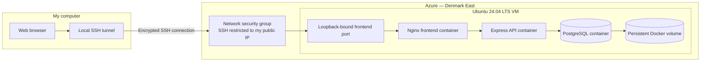
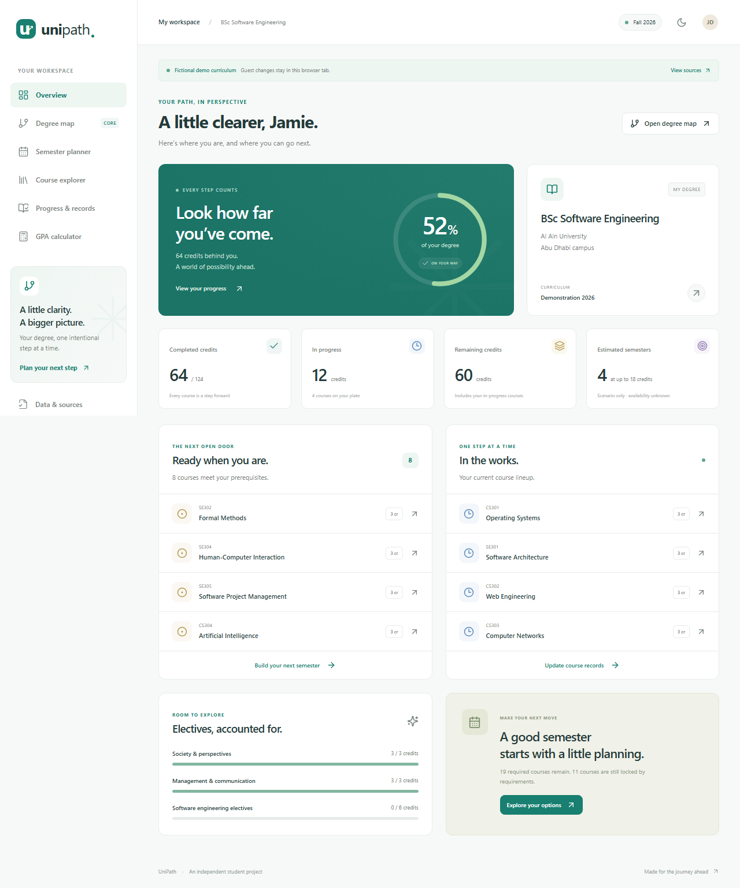
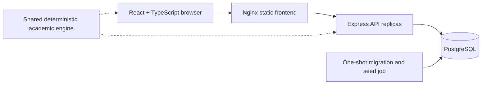

# UniPath on Azure — My First Cloud Project

**A hands-on Azure deployment lab by Faheem Abdul Azees.** I deployed UniPath on an Ubuntu virtual machine, restricted access through SSH, ran its services with Docker Compose, configured budget alerts, and practised persistence, outage recovery, and database backup and restore.

UniPath is the application I used to learn cloud engineering. This repository contains its source code alongside the record of my first Azure project.

**Completed:** 23 October 2026 · **CI and learning record updated:** 24 October 2026

**Deployment:** private preview through an SSH tunnel · **Provisioning:** manual · **Next milestone:** Terraform

[My deployment and learning record](docs/CLOUD-LEARNING.md) · [Architecture](#azure-deployment-architecture) · [Evidence and results](#evidence-and-results) · [Run the application locally](#quick-start-with-docker)

## What I did

My contribution to this cloud milestone was configuring and operating the Azure deployment. The existing React, Express, and PostgreSQL application provided a realistic workload. The application source and automated test tooling are supporting project assets; their presence is separate from the infrastructure work I practised myself.

| Area                     | Hands-on work                                                                                                                                   |
| ------------------------ | ----------------------------------------------------------------------------------------------------------------------------------------------- |
| Azure infrastructure     | Deployed an Ubuntu VM and its networking in an Azure for Students subscription; investigated region and VM-size restrictions.                   |
| Access                   | Restricted SSH to my public IP, connected from Ubuntu on WSL, and accessed the application through an encrypted SSH tunnel.                     |
| Linux and deployment     | Installed Git, Docker and Compose; cloned the private repository with a dedicated read-only deploy key; configured and started the application. |
| Cost awareness           | Configured a US$10 monthly subscription budget for spending alerts. This is an alert threshold, not a spending cap.                             |
| Persistence and recovery | Checked saved records after container restarts, stopped and restarted PostgreSQL, and observed the API's health responses.                      |
| Backup and restore       | Restored a PostgreSQL dump into a separate database, compared record counts, and copied the backup off the VM with a matching SHA-256 checksum. |

## Azure deployment architecture



The browser reaches the VM through a local SSH tunnel. The frontend binds to the VM's loopback interface; port 8080 is not exposed publicly. Docker Compose runs the frontend, API and database on the same VM.

| Deployment component | Recorded configuration                   |
| -------------------- | ---------------------------------------- |
| VM                   | `Standard_B2als_v2` — 2 vCPUs, 4 GiB RAM |
| Operating system     | Ubuntu Server 24.04 LTS                  |
| Region               | Denmark East                             |
| OS disk              | 30 GiB Standard SSD                      |
| Boot security        | Trusted Launch, Secure Boot and vTPM     |
| Resource tags        | `project=unipath`, `environment=dev`     |

## Evidence and results

The [deployment journal](docs/CLOUD-LEARNING.md) records the exercises and their limits. These are historical results, not a claim that the VM is currently running or publicly reachable.

| Exercise                         | Recorded result                                                                                                               | What it establishes                                                                                                             |
| -------------------------------- | ----------------------------------------------------------------------------------------------------------------------------- | ------------------------------------------------------------------------------------------------------------------------------- |
| Container restart                | Account, course progress and saved plan remained available.                                                                   | Persistence across container restarts; not recovery from VM or disk loss.                                                       |
| Database outage                  | Liveness stayed responsive; readiness returned HTTP 503, then recovered when PostgreSQL restarted without restarting the API. | The difference between a running process and an application ready to serve requests.                                            |
| Restore into a separate database | Original and restored counts matched: 1 user, 5 course attempts, 1 semester plan and 1 curriculum.                            | A logical restore and matching counts for these tables; full application sign-in against that restored database was not tested. |
| Off-VM backup                    | The downloaded dump's SHA-256 checksum matched the VM copy.                                                                   | A matching backup copy outside the VM; no scheduled retention policy.                                                           |
| GitHub CI                        | Both jobs passed for commit `14737ea` on 24 October 2026.                                                                     | Repository checks and isolated acceptance tests; not a deployment to Azure.                                                     |

[View the recorded successful GitHub Actions run](https://github.com/Faheem1805/Unipath/actions/runs/40084289991). The workflow checks pushes and pull requests; it does not deploy the application or use the VM's database.

### Application used in the lab



_Application demonstration screenshot. Azure configuration and recovery results are documented in the deployment journal; this image shows the workload, rather than evidence of its hosting location._

## Challenges and lessons

- **Azure size availability:** `NotAvailableForSubscription` blocked the initial UAE North choice. I investigated region permissions, VM-family quota and size availability, then deployed in Denmark East.
- **GitHub authentication:** account-password cloning failed. I used a dedicated read-only SSH deploy key on the VM.
- **SSH key permissions:** a key in Windows Downloads had permissions WSL considered too broad. Moving a copy into the Ubuntu home directory and applying restrictive permissions resolved access.
- **Health checks:** stopping PostgreSQL showed why liveness and readiness must answer different questions.
- **Backups:** a persistent volume survived container restarts, but a separate restore exercise and an off-VM copy gave stronger evidence about recoverability.
- **CI troubleshooting:** fixed-IP test networking and different Docker Compose versions caused acceptance failures. Explicit test subnets, compatible restart commands and redacted diagnostics made those failures diagnosable. These test-tooling fixes are documented separately from my Azure exercises.

## Scope and current limits

This first milestone used a manually configured VM and the development deployment configuration. It is a private learning environment. Public DNS and HTTPS, Terraform provisioning, a deployment pipeline, scheduled backups and retention, zone failover and complete VM recovery are future work.

Auto-shutdown was not completed because the portal's Save button was disabled. Cleanup has not been recorded, so this repository does not assert that all lab resources have been deleted. Budget alerts do not stop spending; retained disks and public IP resources can still incur charges after VM compute is deallocated.

Earlier application verification reports describe the state at the time they were written. Use [the cloud learning record](docs/CLOUD-LEARNING.md) for the later Azure exercises and recorded GitHub CI result.

## Terraform follow-up

[Project two: UniPath on Azure with Terraform](docs/TERRAFORM-AZURE-LAB.md) documents the infrastructure configuration, drift exercise, remote state and recovery work.

## Application overview

**Your degree, in perspective.** UniPath is an independent university degree-planning application connecting a React student workspace to an Express API and PostgreSQL. It includes an interactive degree map, deterministic prerequisite rules, private accounts, saved academic records, semester plans, a course directory, GPA projections, and a protected academic administration workspace.

**Academic data:** the included 124-credit, 47-course curriculum is **entirely fictional**. The university and degree context are Al Ain University, BSc Software Engineering; demo course codes, requirements, electives and suggested terms are not AAU requirements. Verified public facts and unresolved questions are recorded separately in [the source review](database/data/aau-source-review.json). UniPath is not affiliated with or endorsed by AAU.

## Quick start with Docker

Install Docker Engine/Desktop with Docker Compose v2. Use Node.js 22.23.4 for the optional environment generator:

```sh
node scripts/init-env.mjs
docker compose up --build
```

Open **http://localhost:8080**. Choose **Explore the demo**, or create a private account and select the demonstration curriculum. New accounts start with no course records, regardless of semester.

Without Node on the host, copy `.env.example` to `.env`, replace both `CHANGE_ME` values, and keep `POSTGRES_PASSWORD` and the password in `DATABASE_URL` consistent. Use a hexadecimal database password to avoid URL escaping mistakes.

The database waits for readiness, a one-shot migration job applies migrations and an idempotent seed, then the API and frontend start. Only the frontend is published to the host. PostgreSQL data persists in `unipath_unipath-postgres`. `docker compose down` preserves it. `docker compose down -v` **deletes it**.

**Staging:** use the separate [production configuration and release procedure](docs/STAGING.md), not development defaults. Linux container, database and browser checks are recorded in [staging verification](docs/STAGING_VERIFICATION.md); the [original verification report](docs/VERIFICATION.md) and [audit](docs/CODEBASE_AUDIT.md) are historical. The later private Azure deployment is recorded in [the cloud learning journal](docs/CLOUD-LEARNING.md). Public HTTPS and the public proxy path still require acceptance.

## Local development

Prerequisites: Node.js 22.23.4 (container/CI baseline; local Node 24.19.0+ also supported), pnpm 11.25.0, and PostgreSQL 17. Use Corepack or install the pinned pnpm version through npm.

```sh
corepack enable
corepack prepare pnpm@11.25.0 --activate
pnpm install --frozen-lockfile
node scripts/init-env.mjs
pnpm db:generate
pnpm --filter @unipath/shared build
```

Set `DATABASE_URL` in `.env` for your local database. If PostgreSQL is not installed, this development helper starts an actual, persistent PostgreSQL 17 instance on loopback using bundled npm binaries:

```sh
pnpm db:local
```

Leave that terminal running. In a second terminal:

```sh
pnpm db:migrate
pnpm db:seed
pnpm dev
```

Frontend: **http://127.0.0.1:5173**. API: **http://127.0.0.1:3001**. Vite proxies `/api` and `/health`, so cookies use the frontend origin. `pnpm dev` runs both watchers. Restart it after editing shared code, or rebuild shared with `pnpm --filter @unipath/shared build`.

The local database helper is a convenience for development, not a production database supervisor. It writes only to ignored `.local/postgres`, binds to `127.0.0.1`, and stops on Ctrl+C. Existing clusters are preserved. Use the same original credentials when restarting an existing cluster.

## Features

| Workspace              | Behavior                                                                                                                       |
| ---------------------- | ------------------------------------------------------------------------------------------------------------------------------ |
| Landing and onboarding | Responsive UI, campus/version/term selection, explicit data notices, manual course entry                                       |
| Degree map             | React Flow zoom, pan, search, status filter, chain highlighting and course dialog                                              |
| Progress               | Completed, enrolled and unsuccessful attempts per academic term, grades and repeat history                                     |
| Dashboard              | Distinct earned credits, capped elective credits, remaining requirements, eligibility and scenario estimates                   |
| Semester planner       | Concurrent corequisite evaluation, saved term plans, deterministic future sequence and dependency risks                        |
| Course explorer        | Search/category/state filters; term-scoped, sourced instructor and section data or unavailable states                          |
| GPA                    | Published AAU undergraduate numeric scale, configurable scale, weighted semester/cumulative projections and repeat assumptions |
| Accounts               | Scrypt passwords, PostgreSQL opaque sessions, private records, account/password management, export and deletion                |
| Administration         | Draft course/rule/version editing, clone-before-change publishing, atomic CSV/JSON imports and instructor/offering CRUD        |
| Guest demo             | Fictional sample student; changes persist in browser session storage for that tab only                                         |

The map’s **Not planned** state identifies unused elective alternatives whose group requirement is already met. Plans and student course attempts are separate concepts. Courses marked completed are self-reported; UniPath is not an official transcript.

## Architecture and project layout



```text
frontend/       React, Vite, Tailwind, shadcn-style Radix components, React Flow, TanStack Query
backend/        Express, Prisma, authentication, validation, administration, JSON logging
shared/         Academic schemas, prerequisite/credit/GPA engines, fictional demo data
database/       Prisma schema, checked-in SQL migration, reviewed public academic facts
docker/         Multi-stage Dockerfiles and unprivileged Nginx configuration
tests/          Unit, PostgreSQL API, Playwright browser and k6 scenarios
scripts/        Environment, local development database and test helpers
docs/           Architecture/ERD, imports, security, operations, milestones and verification
```

See [architecture and ERD](docs/ARCHITECTURE.md). Academic documents are validated JSON snapshots stored in PostgreSQL, rather than duplicated tables with potentially inconsistent prerequisites. Attempts, profiles, sessions, plans, instructors and offerings are relational records. Version documents allow future universities and programs without code-specific prerequisite decisions.

## Configuration

All deploy-specific configuration comes from environment variables. No frontend API hostname is compiled into the browser bundle.

| Variable                                            | Purpose                                                                                                      |
| --------------------------------------------------- | ------------------------------------------------------------------------------------------------------------ |
| `DATABASE_URL`                                      | Prisma PostgreSQL URL; use connection pool limits, timeouts and verified TLS for managed services            |
| `POSTGRES_USER`, `POSTGRES_PASSWORD`, `POSTGRES_DB` | Compose database initialization; changing them does not modify an existing database volume                   |
| `RATE_LIMIT_SECRET`                                 | Shared random secret (32+ characters) used to hash IP-based rate bucket keys; identical across replicas      |
| `NODE_ENV`                                          | `development`, `test` or `production`                                                                        |
| `PORT`                                              | API listener, default 3001; Compose internally uses 3001                                                     |
| `WEB_PORT`                                          | Compose frontend host port, default 8080                                                                     |
| `CORS_ORIGINS`                                      | Comma-separated exact allowed origins, no trailing slash or wildcard                                         |
| `COOKIE_NAME`, `COOKIE_SECURE`                      | Shared session cookie name; `true` is mandatory in production                                                |
| `SESSION_HOURS`                                     | Absolute session lifetime, 1–720 hours; default 168                                                          |
| `TRUST_PROXY_HOPS`                                  | Trusted proxy hop count, default 0 locally; Compose sets 1 behind its isolated Nginx                         |
| `LOG_LEVEL`                                         | `debug`, `info`, `warn`, `error`, `silent`                                                                   |
| `API_RATE_LIMIT`                                    | Requests per IP per minute, default 300                                                                      |
| `AUTH_RATE_LIMIT`                                   | Authentication mutations per IP per 15 minutes, default 12; shared across login/registration/account changes |
| `SEED_DEMO`                                         | Set `false` to prevent creation of the fictional curriculum                                                  |
| `API_UPSTREAM`                                      | Nginx container’s backend host:port; default `backend:3001`                                                  |
| `TEST_DATABASE_URL`                                 | Test database connection; API suite creates a unique disposable schema                                       |
| `E2E_BASE_URL`                                      | Browser test frontend URL, default `http://127.0.0.1:5173`                                                   |

`PUBLIC_ORIGIN` in the example is an informational deployment hint. Browser security uses `CORS_ORIGINS`; set it to the actual HTTPS origin before production. Production startup refuses insecure cookies, HTTP origins and placeholder rate secrets. TLS termination, trusted proxies, DNS, host hardening and cloud infrastructure are deliberately left to the portfolio owner.

## Database changes and administration

```sh
pnpm db:generate
pnpm db:migrate
pnpm db:seed
```

`db:migrate` uses `prisma migrate deploy`; it never creates development migrations in production. To author a schema change locally, use `pnpm exec prisma migrate dev --schema database/schema.prisma --name your_change`, inspect the SQL and commit it. Run migrations **once per release**, before API replicas start. Replicas only connect and check that the schema exists.

No default administrator or known password is seeded. Bootstrap a local administrator by piping a JSON object containing `email`, `name` and a password of at least 16 characters into `pnpm admin:create`. For a safer interactive method that keeps passwords out of command history, see [operations](docs/OPERATIONS.md#bootstrap-an-administrator). The admin area appears at `/app/admin` after account login and degree setup. Self-registration always creates students.

Use the administration area to import JSON or CSV, inspect source information, edit a draft, validate and publish. Published academic documents are immutable; clone a version to change its requirements. [The import guide](docs/IMPORTS.md) explains the schema and prerequisite operators.

## Testing and builds

```sh
pnpm format:check
pnpm lint
pnpm typecheck
pnpm test:unit
pnpm test:api
pnpm build
pnpm exec playwright install chromium
pnpm test:e2e
pnpm test:containers
pnpm audit
```

`test:api` requires an explicit `TEST_DATABASE_URL` pointing to a disposable database, and creates/drops a randomly named schema. There is no application-URL fallback. Use a test-only database role allowed to create schemas. `pnpm test` runs unit tests and includes API tests only if `TEST_DATABASE_URL` is explicitly set; skipped API tests do not establish persistence verification. `test:containers` creates its own isolated stack and runs the API/browser suites plus operational acceptance automatically.

For standalone browser tests, start the migrated/seeded API and Vite frontend first. The tests run desktop Chromium and an iPhone-sized Chromium viewport. The wrapper creates a synthetic administrator without a student profile, runs student/admin workflows, and removes records uniquely named for that invocation afterward. Explicit `TEST_DATABASE_URL` must point to the disposable database used by that frontend/API. Set `E2E_BOOTSTRAP_ONLY=true` to run the administrator workflow against an empty catalog. Local databases are accepted by default; a disposable remote database requires the explicit `E2E_ALLOW_REMOTE_DATABASE=true` flag. Mobile Safari, Firefox and WebKit were not tested. Reports appear in `playwright-report/`, traces/screenshots in `test-results/`.

The suite covers prerequisite operators, credit thresholds, electives, repeats, GPA, malformed imports, sessions across app instances, private record isolation, authorization, persisted plans, and the essential student browser journeys. See [verification](docs/VERIFICATION.md).

## Load testing

Install [k6](https://grafana.com/docs/k6/latest/set-up/install-k6/), then run against your own local environment:

```sh
k6 run tests/load/unipath.js
```

Scenarios cover homepage requests, concurrent API browsing, curriculum/map retrieval and (with credentials) a private dashboard. Set `BASE_URL` and `ORIGIN` for another local target. Provide `LOAD_EMAIL` and `LOAD_PASSWORD` through environment variables for a synthetic load-test account; no credentials are embedded in the suite. See [operations](docs/OPERATIONS.md#load-testing). No benchmark numbers are claimed.

## Troubleshooting

| Symptom                                                 | Check                                                                                                                                         |
| ------------------------------------------------------- | --------------------------------------------------------------------------------------------------------------------------------------------- |
| `DATABASE_URL` or rate secret validation failure        | Generate `.env`; run commands from the repository root                                                                                        |
| Database authentication failure after changing `.env`   | Credentials in an existing PostgreSQL volume were initialized once; restore the original credentials or deliberately rotate the database role |
| API exits before listening                              | Database connectivity and migrated tables; run the migration job once                                                                         |
| Browser shows request origin verification failure       | Exact URL origin must be listed in `CORS_ORIGINS`, including port; restart API after environment changes                                      |
| Login works but cookies disappear                       | Use one hostname consistently (`localhost` and `127.0.0.1` are different); HTTPS is required for secure cookies                               |
| `429 Too many requests`                                 | Respect `Retry-After`; NAT users share an IP; tune database-backed limits for your deployment/load experiment                                 |
| Progress save returns conflict                          | Another tab changed records; reload and reapply the edit                                                                                      |
| Published curriculum cannot be edited                   | Clone it and publish a distinct version; switching students requires an explicit reset                                                        |
| No sections or instructors                              | No verified offering exists for the selected curriculum, campus and exact academic term                                                       |
| pnpm blocks package scripts                             | Review `allowBuilds` in `pnpm-workspace.yaml`; Prisma and the local database need their listed build scripts                                  |
| Local DB is already running after an interrupted helper | Stop that development cluster with its matching `pg_ctl`; do not remove its data directory. See operations.                                   |

## Boundaries and known limitations

This application supplies portable containers, GitHub Actions verification, health endpoints, operational notes and load scenarios. It does **not** create Azure resources, Terraform, DNS, load balancers, VM Scale Sets or disaster-recovery infrastructure.

Before handling real student records: verify an admission-year-specific curriculum, review grading/repeat rules, secure TLS and database access, establish backup/restore procedures, review retention/privacy policy, perform an independent security review, and decide whether email verification, password recovery and MFA are required. This release has no email service, self-service password recovery, transfer-equivalence engine or official registrar integration. Admin editing uses validated JSON forms intended for trusted data maintainers. Future-term estimates do not solve timetable constraints or prove optimal graduation timing.

Operational procedures: [operations](docs/OPERATIONS.md). Security model: [security](docs/SECURITY.md). Implementation and milestone status: [plan](docs/IMPLEMENTATION-PLAN.md), [milestones](docs/MILESTONES.md).
