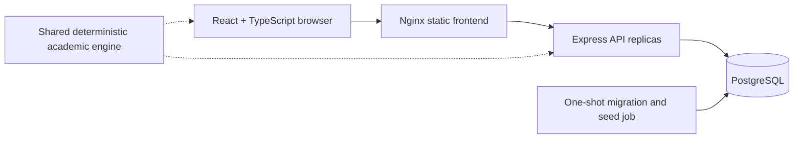

# UniPath

**Your degree, in perspective.** An independent university degree-planning application, built as a portable foundation for an Azure Cloud Engineering portfolio.

UniPath connects a React student workspace to an Express API and PostgreSQL. It includes a genuine interactive degree map, deterministic prerequisite rules, private accounts, saved academic records, semester plans, a course directory, GPA projections, and a protected academic administration workspace.


**Academic data:** the included 124-credit, 47-course curriculum is **entirely fictional**. The university and degree context are Al Ain University, BSc Software Engineering; demo course codes, requirements, electives and suggested terms are not AAU requirements. Verified public facts and unresolved questions are recorded separately in [the source review](database/data/aau-source-review.json). UniPath is not affiliated with or endorsed by AAU.

## Quick start with Docker

Install Docker Engine/Desktop with Docker Compose v2. Use Node.js 22.12+ for the optional environment generator:

```sh
node scripts/init-env.mjs
docker compose up --build
```

Open **http://localhost:8080**. Choose **Explore the demo**, or create a private account and select the demonstration curriculum. New accounts start with no course records, regardless of semester.

Without Node on the host, copy `.env.example` to `.env`, replace both `CHANGE_ME` values, and keep `POSTGRES_PASSWORD` and the password in `DATABASE_URL` consistent. Use a hexadecimal database password to avoid URL escaping mistakes.

The database waits for readiness, a one-shot migration job applies migrations and an idempotent seed, then the API and frontend start. Only the frontend is published to the host. PostgreSQL data persists in `unipath_unipath-postgres`. `docker compose down` preserves it. `docker compose down -v` **deletes it**.

**Verification status:** native PostgreSQL integration and browser tests were run in the authoring environment. Docker is not installed there, so an actual image build and Compose startup remain unverified. See [the verification report](docs/VERIFICATION.md) for exact results and limits.

## Local development

Prerequisites: Node.js 22.12+, pnpm 11.25.0, and PostgreSQL 17. Use Corepack or install the pinned pnpm version through npm.

```sh
corepack enable
corepack prepare pnpm@11.25.0 --activate
pnpm install --frozen-lockfile
node scripts/init-env.mjs
pnpm db:generate
pnpm --filter @unipath/shared build
```

Set `DATABASE_URL` in `.env` for your local database. If PostgreSQL is not installed, this development helper starts an actual, persistent PostgreSQL 17 instance on loopback using bundled npm binaries:

```sh
pnpm db:local
```

Leave that terminal running. In a second terminal:

```sh
pnpm db:migrate
pnpm db:seed
pnpm dev
```

Frontend: **http://127.0.0.1:5173**. API: **http://127.0.0.1:3001**. Vite proxies `/api` and `/health`, so cookies use the frontend origin. `pnpm dev` runs both watchers. Restart it after editing shared code, or rebuild shared with `pnpm --filter @unipath/shared build`.

The local database helper is a convenience for development, not a production database supervisor. It writes only to ignored `.local/postgres`, binds to `127.0.0.1`, and stops on Ctrl+C. Existing clusters are preserved. Use the same original credentials when restarting an existing cluster.

## Features

| Workspace              | Behavior                                                                                                                       |
| ---------------------- | ------------------------------------------------------------------------------------------------------------------------------ |
| Landing and onboarding | Responsive UI, campus/version/term selection, explicit data notices, manual course entry                                       |
| Degree map             | React Flow zoom, pan, search, status filter, chain highlighting and course dialog                                              |
| Progress               | Completed, enrolled and unsuccessful attempts per academic term, grades and repeat history                                     |
| Dashboard              | Distinct earned credits, capped elective credits, remaining requirements, eligibility and scenario estimates                   |
| Semester planner       | Concurrent corequisite evaluation, saved term plans, deterministic future sequence and dependency risks                        |
| Course explorer        | Search/category/state filters; term-scoped, sourced instructor and section data or unavailable states                          |
| GPA                    | Published AAU undergraduate numeric scale, configurable scale, weighted semester/cumulative projections and repeat assumptions |
| Accounts               | Scrypt passwords, PostgreSQL opaque sessions, private records, account/password management, export and deletion                |
| Administration         | Draft course/rule/version editing, clone-before-change publishing, atomic CSV/JSON imports and instructor/offering CRUD        |
| Guest demo             | Fictional sample student; changes persist in browser session storage for that tab only                                         |

The map’s **Not planned** state identifies unused elective alternatives whose group requirement is already met. Plans and student course attempts are separate concepts. Courses marked completed are self-reported; UniPath is not an official transcript.

## Architecture and project layout



```text
frontend/       React, Vite, Tailwind, shadcn-style Radix components, React Flow, TanStack Query
backend/        Express, Prisma, authentication, validation, administration, JSON logging
shared/         Academic schemas, prerequisite/credit/GPA engines, fictional demo data
database/       Prisma schema, checked-in SQL migration, reviewed public academic facts
docker/         Multi-stage Dockerfiles and unprivileged Nginx configuration
tests/          Unit, PostgreSQL API, Playwright browser and k6 scenarios
scripts/        Environment, local development database and test helpers
docs/           Architecture/ERD, imports, security, operations, milestones and verification
```

See [architecture and ERD](docs/ARCHITECTURE.md). Academic documents are validated JSON snapshots stored in PostgreSQL, rather than duplicated tables with potentially inconsistent prerequisites. Attempts, profiles, sessions, plans, instructors and offerings are relational records. Version documents allow future universities and programs without code-specific prerequisite decisions.

## Configuration

All deploy-specific configuration comes from environment variables. No frontend API hostname is compiled into the browser bundle.

| Variable                                            | Purpose                                                                                                      |
| --------------------------------------------------- | ------------------------------------------------------------------------------------------------------------ |
| `DATABASE_URL`                                      | Prisma PostgreSQL URL; use connection pool limits, timeouts and verified TLS for managed services            |
| `POSTGRES_USER`, `POSTGRES_PASSWORD`, `POSTGRES_DB` | Compose database initialization; changing them does not modify an existing database volume                   |
| `RATE_LIMIT_SECRET`                                 | Shared random secret (32+ characters) used to hash IP-based rate bucket keys; identical across replicas      |
| `NODE_ENV`                                          | `development`, `test` or `production`                                                                        |
| `PORT`                                              | API listener, default 3001; Compose internally uses 3001                                                     |
| `WEB_PORT`                                          | Compose frontend host port, default 8080                                                                     |
| `CORS_ORIGINS`                                      | Comma-separated exact allowed origins, no trailing slash or wildcard                                         |
| `COOKIE_NAME`, `COOKIE_SECURE`                      | Shared session cookie name; `true` is mandatory in production                                                |
| `SESSION_HOURS`                                     | Absolute session lifetime, 1–720 hours; default 168                                                          |
| `TRUST_PROXY_HOPS`                                  | Trusted proxy hop count, default 0 locally; Compose sets 1 behind its isolated Nginx                         |
| `LOG_LEVEL`                                         | `debug`, `info`, `warn`, `error`, `silent`                                                                   |
| `API_RATE_LIMIT`                                    | Requests per IP per minute, default 300                                                                      |
| `AUTH_RATE_LIMIT`                                   | Authentication mutations per IP per 15 minutes, default 12; shared across login/registration/account changes |
| `SEED_DEMO`                                         | Set `false` to prevent creation of the fictional curriculum                                                  |
| `API_UPSTREAM`                                      | Nginx container’s backend host:port; default `backend:3001`                                                  |
| `TEST_DATABASE_URL`                                 | Test database connection; API suite creates a unique disposable schema                                       |
| `E2E_BASE_URL`                                      | Browser test frontend URL, default `http://127.0.0.1:5173`                                                   |

`PUBLIC_ORIGIN` in the example is an informational deployment hint. Browser security uses `CORS_ORIGINS`; set it to the actual HTTPS origin before production. Production startup refuses insecure cookies, HTTP origins and placeholder rate secrets. TLS termination, trusted proxies, DNS, host hardening and cloud infrastructure are deliberately left to the portfolio owner.

## Database changes and administration

```sh
pnpm db:generate
pnpm db:migrate
pnpm db:seed
```

`db:migrate` uses `prisma migrate deploy`; it never creates development migrations in production. To author a schema change locally, use `pnpm exec prisma migrate dev --schema database/schema.prisma --name your_change`, inspect the SQL and commit it. Run migrations **once per release**, before API replicas start. Replicas only connect and check that the schema exists.

No default administrator or known password is seeded. Bootstrap a local administrator by piping a JSON object containing `email`, `name` and a password of at least 16 characters into `pnpm admin:create`. For a safer interactive method that keeps passwords out of command history, see [operations](docs/OPERATIONS.md#bootstrap-an-administrator). The admin area appears at `/app/admin` after account login and degree setup. Self-registration always creates students.

Use the administration area to import JSON or CSV, inspect source information, edit a draft, validate and publish. Published academic documents are immutable; clone a version to change its requirements. [The import guide](docs/IMPORTS.md) explains the schema and prerequisite operators.

## Testing and builds

```sh
pnpm typecheck
pnpm test:unit
pnpm test:api
pnpm build
pnpm exec playwright install chromium
pnpm test:e2e
pnpm audit
```

`test:api` requires a running development database and creates/drops a randomly named schema without touching public application tables. Use a test-only database role allowed to create schemas. `pnpm test` runs unit tests and includes API tests only if `TEST_DATABASE_URL` is explicitly set; skipped API tests do not establish persistence verification.

For browser tests, start the migrated/seeded API and Vite frontend first. The tests run desktop Chromium and an iPhone-sized Chromium viewport. The wrapper creates a synthetic administrator, runs student/admin workflows, and removes records uniquely named for that invocation afterward. `DATABASE_URL` must point to the database used by the frontend/API under test. Local databases are accepted by default; a disposable remote database requires the explicit `E2E_ALLOW_REMOTE_DATABASE=true` flag. Use a disposable development database, never a live student database. Mobile Safari, Firefox and WebKit were not tested. Reports appear in `playwright-report/`, traces/screenshots in `test-results/`.

The suite covers prerequisite operators, credit thresholds, electives, repeats, GPA, malformed imports, sessions across app instances, private record isolation, authorization, persisted plans, and the essential student browser journeys. See [verification](docs/VERIFICATION.md).

## Load testing

Install [k6](https://grafana.com/docs/k6/latest/set-up/install-k6/), then run against your own local environment:

```sh
k6 run tests/load/unipath.js
```

Scenarios cover homepage requests, concurrent API browsing, curriculum/map retrieval and (with credentials) a private dashboard. Set `BASE_URL` and `ORIGIN` for another local target. Provide `LOAD_EMAIL` and `LOAD_PASSWORD` through environment variables for a synthetic load-test account; no credentials are embedded in the suite. See [operations](docs/OPERATIONS.md#load-testing). No benchmark numbers are claimed.

## Troubleshooting

| Symptom                                                 | Check                                                                                                                                         |
| ------------------------------------------------------- | --------------------------------------------------------------------------------------------------------------------------------------------- |
| `DATABASE_URL` or rate secret validation failure        | Generate `.env`; run commands from the repository root                                                                                        |
| Database authentication failure after changing `.env`   | Credentials in an existing PostgreSQL volume were initialized once; restore the original credentials or deliberately rotate the database role |
| API exits before listening                              | Database connectivity and migrated tables; run the migration job once                                                                         |
| Browser shows request origin verification failure       | Exact URL origin must be listed in `CORS_ORIGINS`, including port; restart API after environment changes                                      |
| Login works but cookies disappear                       | Use one hostname consistently (`localhost` and `127.0.0.1` are different); HTTPS is required for secure cookies                               |
| `429 Too many requests`                                 | Respect `Retry-After`; NAT users share an IP; tune database-backed limits for your deployment/load experiment                                 |
| Progress save returns conflict                          | Another tab changed records; reload and reapply the edit                                                                                      |
| Published curriculum cannot be edited                   | Clone it and publish a distinct version; switching students requires an explicit reset                                                        |
| No sections or instructors                              | No verified offering exists for the selected curriculum, campus and exact academic term                                                       |
| pnpm blocks package scripts                             | Review `allowBuilds` in `pnpm-workspace.yaml`; Prisma and the local database need their listed build scripts                                  |
| Local DB is already running after an interrupted helper | Stop that development cluster with its matching `pg_ctl`; do not remove its data directory. See operations.                                   |

## Boundaries and known limitations

This application supplies portable containers, health endpoints, operational notes and load scenarios. It does **not** create Azure resources, Terraform, CI/CD, DNS, load balancers, VM Scale Sets or disaster-recovery infrastructure.

Before handling real student records: verify an admission-year-specific curriculum, review grading/repeat rules, secure TLS and database access, establish backup/restore procedures, review retention/privacy policy, perform an independent security review, and decide whether email verification, password recovery and MFA are required. This release has no email service, self-service password recovery, transfer-equivalence engine or official registrar integration. Admin editing uses validated JSON forms intended for trusted data maintainers. Future-term estimates do not solve timetable constraints or prove optimal graduation timing.

Operational procedures: [operations](docs/OPERATIONS.md). Security model: [security](docs/SECURITY.md). Implementation and milestone status: [plan](docs/IMPLEMENTATION-PLAN.md), [milestones](docs/MILESTONES.md).
