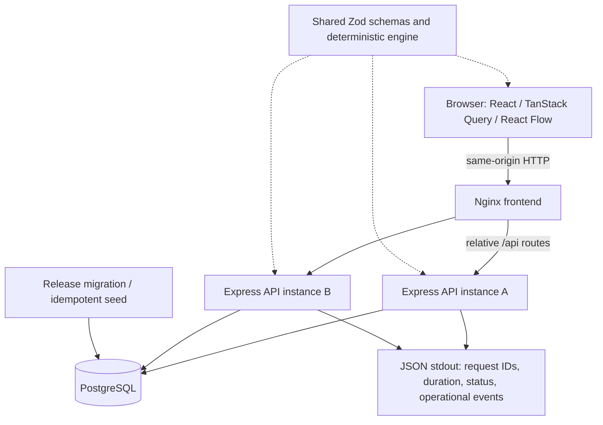
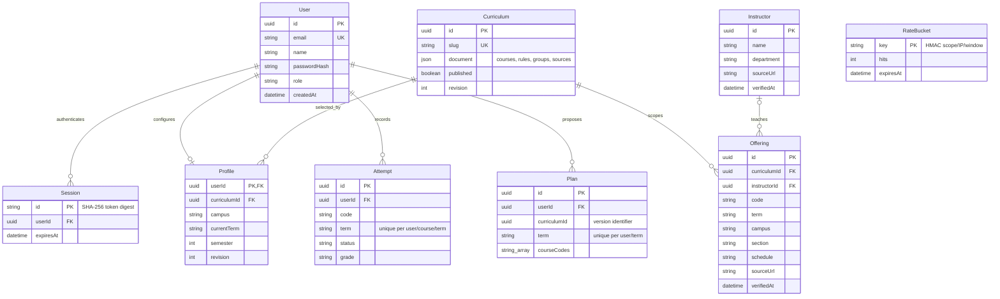

# Architecture and data model

The application is a modular monolith with three deployable services: static frontend, stateless API and PostgreSQL. The migration job is a release step, not a request-serving replica. No essential feature requires a proprietary hosted service.

## Database ERD

`Course`, elective groups and prerequisite expressions are embedded in an immutable, validated curriculum document. This keeps a coherent academic version together and permits atomic imports. Course identifiers are scoped to that document; offerings are validated against it. `Plan.curriculumId` records the version but intentionally is not a foreign key: adoption/reset procedures and immutable published versions enforce application-level consistency. One account has one active profile; changing its curriculum explicitly clears its attempts/plans.

## Academic calculations

The rule evaluator accepts completed course codes, same-term concurrent codes and earned **degree** credits. A course prerequisite requires completion; an enrolled prerequisite is insufficient. A corequisite can be complete or part of the concurrent set. AND/OR expressions preserve their actual Boolean meaning. Credit thresholds use deduplicated, elective-capped degree credits. Approval rules stay blocked until manually confirmed outside the planner; there is no student permission override.

Required courses earn credits once regardless of repeated attempts. Elective groups count the lesser of earned group credits and their requirement. Excess alternatives never inflate degree percentage. In-progress credits use the additional degree credits that would be earned after current enrollment; they cannot consume an already satisfied elective bucket. Remaining credits include in-progress credits until they are completed. Required-course counts exclude elective alternatives; elective deficits are shown independently.

Future sequencing is a deterministic bounded greedy heuristic that prioritizes courses with downstream dependencies and bundles corequisites when feasible. It checks prior-term requirements, respects a hypothetical credit load and stops with unresolved credits if it cannot advance. Course availability, timetable conflicts, minimum offerings frequency, failed courses and optimality are not modeled. OR branches may contribute to dependency counts; these counts indicate connected possibilities, not a formal critical-path proof.

GPA uses credit-weighted grade points. A recorded grade is separate from credit completion. The calculator exposes all/latest/best repeat policies as assumptions and uses entered quality points for cumulative projections. It cannot undo repeat credits hidden inside a previous aggregate GPA.

## Consistency and replicas

Opaque sessions, rate counters and student state are stored in PostgreSQL. No request depends on the API instance that received the previous request. No uploads or runtime student records use local disk. Progress writes use optimistic revisions. Profile/curriculum transitions and plan updates use database transactions. Published or adopted versions cannot change academic content; clones form new versions.

The API waits for a database connection and required table before listening. `/health/live` checks the running process; `/health/ready` checks PostgreSQL connectivity. SIGTERM/SIGINT stop accepting connections, drain active requests and disconnect Prisma, with a bounded shutdown deadline. Each replica periodically prunes expired sessions and rate buckets; duplicate cleanup is safe.
