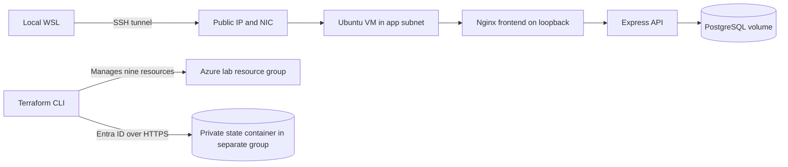

# UniPath on Azure with Terraform

[Failure playbook and interview practice](FAILURE-PLAYBOOK.md)

This second cloud project rebuilt the original UniPath deployment as infrastructure as code. The application runs on one Ubuntu VM using Docker Compose. Nginx serves the React frontend, Express handles the API, and PostgreSQL persists records in a Docker volume.

The network uses one VNet and one subnet. The subnet NSG allows TCP port 22 from one public IPv4 address. The web frontend binds to loopback, so normal browser access uses an SSH tunnel.

## Verified exercises

| Exercise                    | Result                                                                                                                                            |
| --------------------------- | ------------------------------------------------------------------------------------------------------------------------------------------------- |
| Infrastructure provisioning | Created nine Terraform resources and reached the Ubuntu VM over SSH.                                                                              |
| NSG diagnosis               | Fixed an SSH timeout by replacing the workstation's private LAN address with the current internet-facing IPv4 address and a `/32` prefix.         |
| Application deployment      | Started the original UniPath stack using Docker Compose and verified it through the SSH tunnel.                                                   |
| Reboot recovery             | Reconnected after a VM reboot and confirmed Docker, UniPath and saved data recovered.                                                             |
| In-place change             | Updated six resources through a shared Terraform tag.                                                                                             |
| Drift                       | Changed the VM tag manually, then used Terraform to detect and restore the declared value.                                                        |
| State migration             | Moved local state into a private Azure Blob container using Entra authentication. Verified the blob, all nine state entries and a no-change plan. |

## Rebuild and recovery results

1. Exported PostgreSQL in custom format and restored it into a temporary database on the original VM. The restore completed and exposed 10 tables in the public schema.
2. Exported the deployed source and PostgreSQL dump, transferred the bundle through a private Azure Blob, and matched its SHA-256 checksum against the VM's copy. Retained a private off-VM copy.
3. Reviewed the destroy plan and verified that all nine deletions belonged to the project-two lab. Terraform destroyed all nine resources, then recreated all nine from the same configuration and remote backend. A fresh plan reported no changes.
4. Installed Docker on the replacement VM, deployed the archived source, generated new runtime credentials, and restored the database before starting the application. PostgreSQL reported one user, one saved plan and zero course attempts. The homepage and API readiness both returned HTTP 200 on the VM.

## State and cost controls

The state account is in its own resource group so it survives lab teardown. Its blob container requires authorization and the account disables anonymous blob access and Shared Key authentication. Terraform accesses it through Azure CLI sign-in and an Azure role assignment.

The $10 USD monthly budget covers both UniPath resource groups, with alerts at $8 and $10. The budget sends notifications and does not cap spending. Azure rejected the native shutdown schedule because the VM region lacks the schedule resource and subscription policy blocked the alternative region. Use deallocation to stop compute billing when idle. Disks, public IPs and storage may still incur charges.

## Reproducing the deployment

The Terraform configuration is under `infrastructure/terraform`. Review the subscription, location, VM size, SSH public key and SSH source IP. Initialize the backend with an authorized Azure CLI session, inspect the plan and apply it. The backend storage and its data permissions are a separate prerequisite.

Install Docker Engine and Compose on the VM. Deploy the original UniPath source, generate its private environment file, and start the Compose services. Confirm the frontend and API readiness through the VM's loopback port. Use an SSH tunnel to reach the browser UI.

Before tearing down the app resource group, export PostgreSQL and verify an off-VM copy. Infrastructure state and PostgreSQL backups serve different purposes. A Terraform rebuild recreates the Azure resources, and PostgreSQL restore recovers the application records.

Keep state files, plans, real variable values, credentials and database backups out of Git.
